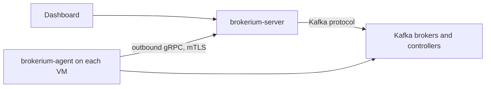

# Brokerium for Apache Kafka

Brokerium is a control plane and web dashboard for Apache Kafka® clusters, in the
spirit of Rancher for Kubernetes. One place to see every cluster, scale brokers and
KRaft controllers on the fly, drain and replace nodes, rebalance data across brokers,
upgrade Kafka versions, and manage topics, users, ACLs and messages.

> **Status: pre-alpha.** Brokerium is under active development. Interfaces and storage
> formats may change between releases. Do not point it at production clusters yet.

## Why Brokerium

Existing tools cover only part of the job: data-plane UIs browse topics and messages,
Strimzi automates Kafka only on Kubernetes, and Cruise Control rebalances partitions
without a UI and without knowing about controllers. Brokerium covers the whole
lifecycle of KRaft clusters on virtual machines, bare metal, Kubernetes and managed
services:

- **Multi-cluster dashboard:** health, brokers (including fenced ones), the KRaft
  controller quorum with voters, observers and lag, topics, partition distribution,
  consumer groups and configuration.
- **Controllers without downtime:** add and remove KRaft controllers in dynamic
  quorums, and migrate static quorums to dynamic ones.
- **Broker lifecycle:** add brokers, cordon and drain a broker, replace a failed
  broker, decommission and unregister it.
- **Rebalancing you control:** move replicas and leaders by hand with a preview, or
  balance the whole cluster evenly in one click, with throttling and health checks
  between batches.
- **Rolling upgrades:** one node at a time with health gates, then explicit
  finalization of the new metadata version.
- **Data plane:** topics, ACLs, SCRAM users, quotas, consumer groups and offsets,
  message browsing and producing.

## How it works



- `brokerium-server` is a single Go binary with the API, the dashboard, the
  operations engine and the rebalancing planner. It stores its state in PostgreSQL.
- Data-plane features and rebalancing need nothing on the brokers: Brokerium talks
  the Kafka protocol with a service account.
- Node lifecycle on virtual machines (install, format, start, stop, upgrade) uses a
  small `brokerium-agent` on each host. The agent connects out to the server and
  executes only a fixed set of typed commands.
- On Kubernetes Brokerium works through Strimzi; on managed services (Amazon MSK,
  Confluent Cloud, Aiven) it offers what the provider allows.

## Quick start (local lab)

Requirements: Docker Desktop with at least 6 CPUs and 16 GB of memory, and
[mise](https://mise.jdx.dev) for the pinned toolchain.

```bash
mise install
make lab-up      # Kafka 4.3.1 cluster "alpha": 3 controllers + 3 brokers
make dev         # Brokerium server on http://localhost:8080
```

See [docs/runbooks/](docs/runbooks/) for the lab scenarios.

## Documentation

- [Architecture decisions](docs/adr/)
- [Roadmap](docs/ROADMAP.md)
- [Research notes on Kafka 4.x operations](docs/research/)
- [Runbooks](docs/runbooks/)

## License

Brokerium is **source-available** under the
[PolyForm Shield License 1.0.0](LICENSE): free to use, including in production,
but you may not use it to build a competing product. Read the plain-language
summary in [LICENSING.md](LICENSING.md).

Contributions are welcome under the [CLA](CLA.md); see [CONTRIBUTING.md](CONTRIBUTING.md).

Apache®, Apache Kafka® and Kafka® are either registered trademarks or trademarks of
the Apache Software Foundation in the United States and/or other countries.
Brokerium is not affiliated with, endorsed by, or sponsored by the Apache Software
Foundation.
